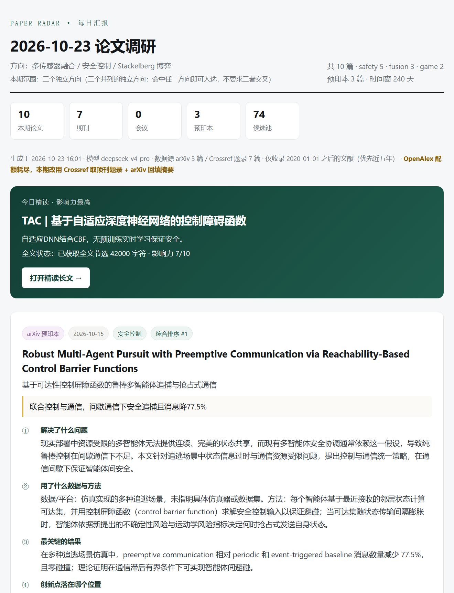
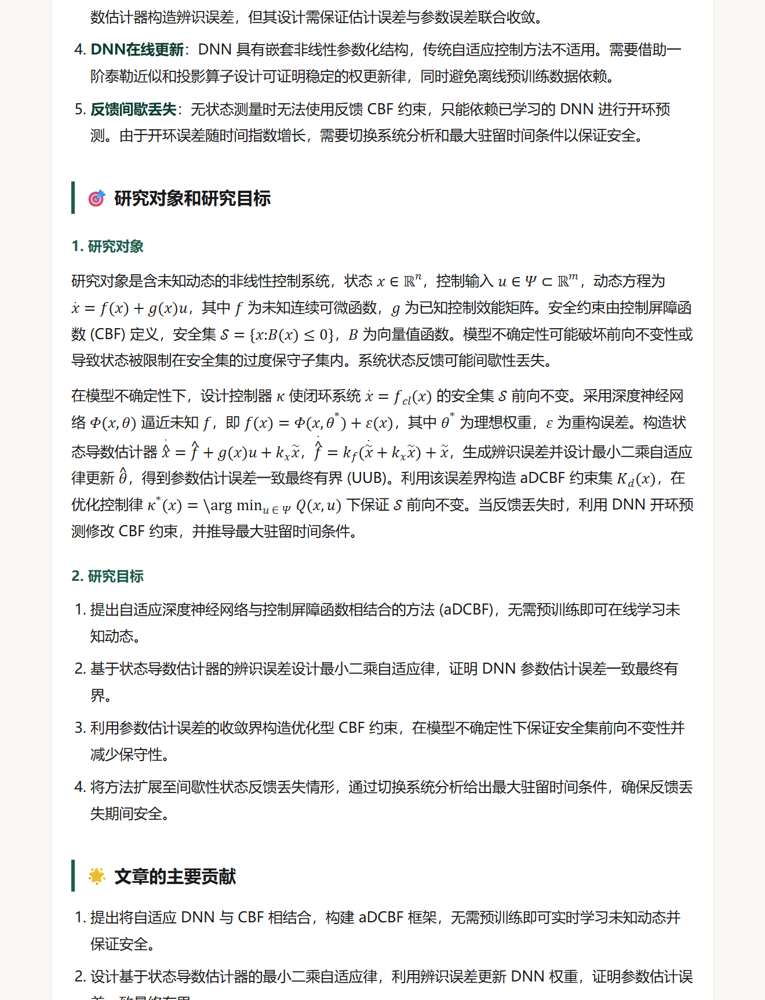

# 论文雷达 · Paper Radar

> 每天定点，把指定顶刊/顶会的新论文，变成一份**能直接读**的中文调研。

给定研究方向 + 一组 venue，它每天自动产出一份汇报：

- **10 篇论文的六问速读** —— 每篇都回答同样六个问题（解决了什么 / 用了什么数据方法 / 最关键结果 / 创新点在哪 / 遗留问题 / 下一步怎么做）
- **1 篇精读长文** —— 从这 10 篇里挑影响力最高的一篇，按微信公众号「论文速递」的十个板块写成可读长文，**公式是真正的数学排版**
- **周日额外一份周综述** —— 三条技术主线 + 本周最值得读的三篇 + 「没人做但该做」的空缺

产物是**单文件 HTML**（可双击看、可打印、可直接转发），另有一个本地看板。企业微信推送是**可选功能**，不配置完全不影响使用。

> **这个仓库不预置任何研究方向** —— 盯什么方向、看哪些期刊会议，装的时候由你回答，向导会把你的回答变成配置。别人 clone 下来同样是空白起点。

<p align="center">
  
  
</p>

<p align="center"><sub>左：每日 10 篇六问调研　·　右：精读长文，行内公式为浏览器原生 MathML</sub></p>

---

## 快速开始

### 0. 前置

- Python **3.9+**
- 一个 **OpenAI 兼容**的模型接口及 API Key（DeepSeek / OpenAI / 通义 / 本地 vLLM 都行）
- 不需要数据库、不需要公网 IP、不需要 Docker

### 1. 装依赖

```bash
git clone <你的仓库地址> paper-radar
cd paper-radar
python -m venv .venv

# Windows
.venv\Scripts\python.exe -m pip install -r requirements.txt
# macOS / Linux
./.venv/bin/python -m pip install -r requirements.txt
```

> Windows 用户也可以直接双击 `start.bat`：它会自动建虚拟环境、装依赖、缺配置时拉起向导，然后打开看板。

### 2. 回答问题（向导会问你两个必答项）

```bash
python setup.py
```

它按顺序做四件事：

| 步骤 | 内容 | 产物 |
|---|---|---|
| 体检 | Python 版本、依赖是否齐全 | 只打印 |
| **模型** | 接口地址 + API Key + 模型名，当场跑连通测试 | `data/llm.json` |
| **研究方向** | ① 你盯哪些方向 ② 你要盯哪些期刊/会议 ③ 写给谁看 | `config.json` |
| 可选 | 企业微信推送（可以直接跳过） | `data/wecom.json` |

两个问题的样子：

```
你的研究方向是什么？（可以有多个并列方向，命中任一即入报）
  例：图神经网络 / 因果推断 / 强化学习 —— 用中文或英文都行，回车结束。
    方向 1：图神经网络
    方向 2：因果推断
    方向 3：            ← 回车结束

要盯哪些期刊和会议？（逗号分隔，可混写；留空则只用 arXiv）
  例：Nature Machine Intelligence, IEEE TPAMI, NeurIPS, ICML —— 也可以写 issn:2522-5839 或 S4210221977
```

**关键词不用你手写**：向导会调用你刚配好的模型，把方向名展开成 20–30 个英文检索词和一条 arXiv 查询串；期刊名会自动去查 ISSN，会议名会去查 OpenAlex source id。确认一下就写进 `config.json`。

非交互（给 AI agent 用）：

```bash
python setup.py --base-url https://api.deepseek.com/v1 --api-key sk-xxx \
                --model deepseek-v4-pro --flash-model deepseek-flash \
                --topic "图神经网络" --topic "因果推断" \
                --venue "Nature Machine Intelligence" --venue "IEEE TPAMI" \
                --audience "课题组的研究生" --daily 10
```

`data/llm.json`（Key）和 `config.json`（你的方向）**都在 `.gitignore` 里，不会被提交**。

### 3. 先试跑一次

```bash
python pipeline.py --dry-run     # 只取文、不调模型，不花钱，先看能不能捞到论文
python pipeline.py               # 正式生成今天的 10 篇 + 1 篇精读（3–6 分钟）
python server.py                 # 看板：http://127.0.0.1:8780
```

产物在 `data/reports/`、`data/deepread/`、`data/weekly/`。

---

## 改方向 / 改取文范围

最省事的是重跑向导，它会重新问一遍并覆盖 `config.json`（模型配置不动）：

```bash
python setup.py --reconfigure
```

也可以只换方向、不重新回答期刊：

```bash
python setup.py --reconfigure --topic "分子动力学" --venue "Nature Machine Intelligence"
```

想手工调就改 `config.json`（这个文件由向导生成，**不在仓库里**）：

| 字段 | 作用 |
|---|---|
| `field_name` | 方向总名，会注入所有提示词（多个方向用「A / B / C」表示**并列**，命中任一即入选） |
| `topics` | 方向列表，每项含 `key` / `name` / `short` / `weight` / `keywords` / `arxiv`。**`keywords` 决定召回质量，宁可具体不要宽泛** |
| `venues` | 取文范围。期刊给 ISSN，会议给 OpenAlex source id |
| `audience` | 读者定位（「写给谁看」），注入六问 / 精读 / 周报的提示词 |
| `daily_target` | 每天几篇（默认 10） |
| `min_pub_date` | 文献时间下限（默认 `2020-01-01`，硬约束） |
| `window_days_ladder` | 时间窗逐级放宽阶梯（天） |
| `openalex_api_key` | 可选。OpenAlex 免费额度按 IP 共享、容易被用尽，填自己的 key 更稳（免费申请） |

改完先跑 `python pipeline.py --dry-run`，看日志里每个方向各捞到几篇。**方向失衡最常见的原因是某个 topic 的 keywords 太窄、或者指定期刊里这个方向本来就少**，加同义词或补几个会议即可。

> 只想看一个方向：`python pipeline.py --topic graph_neural`（写 `topics[].key`，也可以写中文名片段）。

---

## 接到定时任务（这一步交给你的 AI agent）

本仓库**不含调度器** —— 这是刻意设计：调度、失败重试、结果汇报都交给宿主环境，脚本只负责「生成一次」。这样它在 WorkBuddy / Claude Code / Cursor 里能跑，用系统 cron 也能跑。

### 方式一：让 AI agent 配（推荐）

把 [`docs/AGENT_SETUP.md`](docs/AGENT_SETUP.md) 整个文件复制给你的 agent（WorkBuddy、Claude Code、Cursor 等能读写文件、能建定时任务的都行），它会自己完成安装、配置、试跑和两条定时任务的创建。

它的目标形态是两条任务：

| 任务   | 时间       | 动作                                                            |
| ---- | -------- | ------------------------------------------------------------- |
| 每日调研 | 每天 09:00 | `pipeline.py` → 校验 10 篇六问无空项 → 汇报方向分布 / 精读选了哪篇 / 数据源状态        |
| 每周综述 | 周日 09:00 | `pipeline.py --weekly` → 校验 threads / top3 / gaps 非空 → 汇报三条主线 |

### 方式二：系统 cron

```cron
# 每天 09:00 出日报
0 9 * * *  cd /path/to/paper-radar && ./.venv/bin/python pipeline.py >> data/cron.log 2>&1

# 每周日 09:00 出周报
0 9 * * 0  cd /path/to/paper-radar && ./.venv/bin/python pipeline.py --weekly >> data/cron.log 2>&1
```

Windows 用「任务计划程序」，程序填 `.venv\Scripts\python.exe`，参数填 `pipeline.py`，起始位置填项目目录。

### 当天想重跑

```bash
python pipeline.py --force      # 覆盖当天产物
python pipeline.py --resume     # 复用已生成的速读，只补精读与渲染（省 token）
python pipeline.py --no-wecom   # 本次不推送企业微信
```

---

## 推送到企业微信（可选）

**不配置也能用**：默认 `enabled=false`，所有推送调用会静默跳过，不报错、不影响日报生成。

配置后，每天早上会收到一条摘要 + 两个 HTML 文件：

| 附件                  | 内容             |
| ------------------- | -------------- |
| `每日十篇泛读_MM.DD.html` | 当天 10 篇的六问调研全文 |
| `每日精读_MM.DD.html`   | 当日精读长文（公式已排版）  |

**步骤**：企业微信管理后台 → 应用管理 → **智能机器人** → 你的机器人 → 连接方式选「API 模式 / 使用长连接」→ 记下 **Bot ID** 与 **Secret**，然后：

```bash
pip install websockets                      # 可选依赖
python wecom_bind.py --bot-id 你的BotID --secret 你的Secret
```

脚本会连上长连接等 180 秒 —— 这期间去**机器人所在的群 @ 它发一句话**（或直接私聊它发一条）。抓到会话后自动存盘、回一条「绑定成功」、打开推送开关。

> 用官方长连接协议（`wss://openws.work.weixin.qq.com`），不依赖第三方 SDK；发送策略是「临时建连 → 逐条发 → 断开」，不常驻进程，也不会和别处的长连接互踢。

**两个容易踩的坑**（都在代码里处理了，这里说明现象，省你排查时间）：

1. **未与机器人交互过的会话，发消息会返回 `errcode=846607 send msg frequency limit exceeded`**。这个报错文案有误导性 —— 真实含义是**前置条件未满足**（该会话还没给机器人发过消息），不是超频，也不是 IP 被封。而且 `enter_chat` 这类事件回调**不算**交互，必须真的发一条消息。
2. **服务端推来的 `aibot_msg_callback` 帧也带 `headers.req_id`**。判断一条帧是不是自己的 ack，只能看这个 req_id 是否在「自己发出的待应答表」里，不能靠「有没有 req_id」。

---

## 看板

```bash
python server.py     # http://127.0.0.1:8780
```

- 历史日报 / 精读 / 周报浏览
- 一键生成今日 10 篇、生成周报，实时看日志
- 模型连通测试、企业微信测试与重发
- 纯标准库 HTTP 服务，无前端构建步骤

---

## 它是怎么工作的

### 数据源

- **OpenAlex**：主数据源。按 `venues` 里的 ISSN / source id 过滤，按 `from_publication_date` 卡时间下限。
- **Crossref**：OpenAlex 配额耗尽（HTTP 429）时自动兜底。
- **arXiv**：指定 venue 不足时按方向关键词补预印本，并在产物里明确标注「预印本」。

### 排序与时间窗

按「时效梯度」加权：≤3 个月 3.0 分、≤1 年 2.4、≤2 年 1.6、≤3 年 1.0、更老 0.2，再叠加方向权重与关键词命中度。

时间窗自动逐级放宽 `90 → 150 → 240 → 365 → 550 → 800` 天，直到篇数够**且每个方向都不为空**，避免某一天被单个方向占满。

预印本占比有上限（默认 40%）：如果某个方向在你指定的期刊里几乎没有新文，它只能靠 arXiv 补，这时该方向篇数会偏少 —— 日志里会提示「有方向偏空」，加会议或放宽关键词即可。

### 去重

`data/seen.json` 记录已推送过的论文 id，第二天不会重复。想重来就删掉它。

### 反编造

提示词层面硬约束：只能依据标题 / 摘要 / venue 作答，摘要没写的一律输出「摘要未披露」，不得编造实验数字、基线、定理编号。

### 公式渲染

模型输出的 LaTeX（`$...$`）在**生成时**由 `radar/mathml.py` 转成 **MathML** 内联进 HTML。不引入 KaTeX/MathJax，因为产物要能双击打开、断网可看、打印是矢量；MathML 是浏览器原生能力（Chrome 109+ / Edge / Firefox / Safari）。转不动的表达式退化成带底色的 LaTeX 源码（`<code class="tex">`），不会污染正文。

### 精读全文

有开放 PDF 时用 `pypdf` 抓全文（最多 42000 字符）再写；IEEE 等闭源期刊拿不到全文时，只写摘要能支撑的部分，并在稿子里标明「仅依据摘要」。

---

## 目录结构

```
config.json              你的方向与取文范围（由向导生成，不入库）
config.example.json      配置骨架（空的，仅示意结构）
setup.py                 安装向导（体检 + 模型 + 研究方向 + 取文范围）
pipeline.py              主流水线：取文 → 排序 → 六问 → 精读 → 渲染 →（可选）推送
server.py                本地看板（纯标准库）
wecom_bind.py            企业微信绑定工具（可选）
start.bat                Windows 一键启动
requirements.txt         依赖（websockets 为可选）
prompts/                 六问 / 精读 / 周报的提示词模板
radar/
  config.py              路径、配置加载与默认值
  bootstrap.py           把方向名展开成关键词、期刊名解析成 ISSN/会议 id
  sources.py             OpenAlex + Crossref + arXiv 取文
  rank.py                时效梯度与方向均衡
  analyze.py             六问生成
  deepread.py            精读生成与渲染
  report.py              日报 HTML 渲染
  weekly.py              周报生成
  llm.py                 模型调用（JSON 模式、截断重试）
  mathml.py              LaTeX → MathML
  wecom.py               企业微信长连接（可选）
web/                     看板前端
data/
  llm.example.json       模型配置模板
  wecom.example.json     企业微信配置模板
  reports/ deepread/ weekly/    运行产物（已 gitignore）
docs/AGENT_SETUP.md      给 AI agent 的安装提示词
```

---

## 常见问题

**仓库里为什么没有 `config.json`？** 因为它装的是你的研究方向，因人而异，所以不入库。`python setup.py` 回答两个问题就会生成；没配就跑 `pipeline.py` 会直接提示 `[配置未完成]` 并以退出码 3 结束。

**向导展开的关键词不理想？** 交互模式下每个方向都会问一句「就这样？」，答 n 就能手工填英文关键词。也可以事后改 `config.json` 的 `topics[].keywords`，再 `--dry-run` 看效果。

**第一次跑就 0 篇？** 先 `--dry-run` 看日志：`venues` 的 ISSN 是否正确、`min_pub_date` 是否太近、`topics[].keywords` 是否太窄。

**OpenAlex 返回 429？** 免费配额按天计，耗尽后自动切 Crossref 兜底；`Retry-After` 常常是几万秒（配额重置时间），代码不会傻等。

**模型输出被截断？** 推理型模型会把 token 花在 `reasoning_content` 上。代码已按 `finish_reason=length` 检测并加大预算重试；如果你的模型特别啰嗦，调大 `radar/llm.py` 里的预算或换非推理模型。

**精读只有摘要支撑？** 说明这篇没有开放 PDF（IEEE / Elsevier 常见）。这是数据源限制，不是 bug；稿件里会标注。

**能跑在服务器上吗？** 能，`pipeline.py` 无 GUI 依赖。只有 `server.py` 是给人看的，可不必跑。

---

## License

[MIT](LICENSE)。论文元数据来自 OpenAlex / Crossref / arXiv，请遵守各自的 API 条款；生成的调研内容仅供参考，**引用前请核对原文**。
